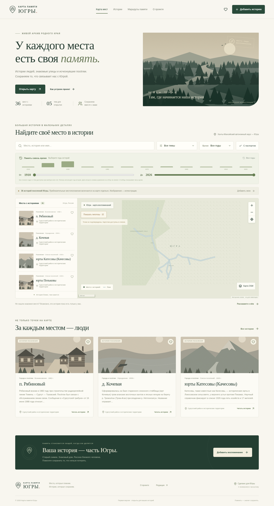

# Карта памяти Югры

Авторский проект АНО «Север с воды» — Автономной некоммерческой организации развития водного туризма и краеведения «Север с воды». ИНН 8600005365, ОГРН 1268600007290. Контакт: novichek2@yandex.ru. Оригинальные материалы и оформление проекта: все права защищены; права на материалы других авторов сохраняются за правообладателями.

Самостоятельное приложение живого архива (версия 0.2): интерактивная карта, истории мест и людей, воспоминания жителей и редакторская модерация. Исходники «Сплава» не используются и не изменяются.



## Что уже работает

- Адаптивный интерфейс на русском языке: карта, истории, воспоминания жителей, тематические маршруты, страница проекта.
- 36 карточек объектов из предоставленных паспортов Сургутского района. Использован исправленный рабочий свод; копии и старый GPS-атлас не смешиваются с ним. По подтверждению владельца проекта от 29 октября 2026 года все 36 паспортов отмечены как проверенные. Дата и основание подтверждения сохранены в данных. В исходном каталоге используются авторские иллюстрации. Загруженные фотографии помечаются отдельно и имеют собственное описание источника и прав.
- На карте показаны 32 приблизительных местоположения с пояснением и возможностью их отключить. У Пеньковых, Летнего, устьевых юрт Агана и Кедрового точное положение не установлено; точки для них не подставляются. У 6 объектов нет точной датировки: они доступны при выборе всех лет.
- Старые 8 демонстрационных примеров сохранены в БД для совместимости со ссылками, но скрыты из основного каталога после загрузки паспортов.
- Настоящие Яндекс Карты по умолчанию: масштабирование, перемещение и точки из координат паспортов. Выбор места в списке приближает его точку. Альтернатива — OpenStreetMap на Leaflet с переходом из маркера в карточку. В карточках есть ссылки на Яндекс и Google Maps.
- Поиск точки по координатам работает и на статическом сайте. Формы приёма и редакторской правки понимают десятичные градусы с точкой/запятой и градусы, минуты, секунды; показывают предварительную карту перед отправкой.
- Четырнадцать подготовленных воспоминаний о Песчаном, Нагорном, Чёрном Мысе, Широковой, Банном, Ореховском, Тром-Агане и Рыбачьем: поиск по автору и поселению, краткие цитаты, отдельный пересказ и ссылки на оригинальные публикации. Источники и границы отбора — в [MEMORIES.md](docs/MEMORIES.md).
- Поиск, фильтры по теме и десятилетию, временная шкала с диапазоном лет, отбором по типу события и распределением карточек по десятилетиям, сортировка и скрытие демонстрационных материалов. Шкала использует год указанного события (перепись, основание, упразднение и др.), а не обязательно год основания. Даты снимков и воспоминаний на этот отбор не влияют.
- Карточки с текстом, авторством и источниками; избранное в браузере; ссылки на отдельные истории. Дополнение из карточки сохраняет связь с местом после модерации и показывается в «Воспоминаниях». Название места подставляется в форму, неизвестный год можно не указывать.
- Отправка воспоминания с одним или двумя снимками до 2 МБ каждый (JPEG, PNG, WebP), источниками и согласием. Для пары — сравнение «тогда и сейчас» с ползунком, клавиатурным управлением и режимом просмотра рядом. Для каждого снимка предусмотрены отдельные сведения о фотографе, дате, источнике и основании использования. Дата съёмки не берётся из года исторического события; неизвестная дата первого снимка так и подписывается.
- Реальная SQLite-база. Отправленный материал не публикуется до решения редактора. Частные контакты не выдаются публичным API; неопубликованные фотографии закрыты от посетителей.
- Кабинет редактора: очередь, просмотр, уточнение текста, дат, координат и источников перед публикацией, история исходной и исправленной версии, публикация и отклонение. Конфликтующие изменения и публикация устаревшей версии блокируются. Системные поля, согласие, частный контакт и владельцы фотографий не редактируются этим API.
- Пароли редакторов хешируются через scrypt; серверные сессии с HttpOnly/SameSite cookie, выход отзывает сессию. Встроенных паролей, публичной регистрации редакторов и назначения прав по email нет.
- Ограничение запросов к входу и отправке материалов, проверка данных на сервере, защита от запросов с чужого сайта. Пользовательский текст выводится как текст, включая подписи на карте.

## Карточки из паспортов объектов

В форме отправки материала и в редакторской правке есть раздел **«Сведения из паспорта объекта»**. Можно перенести официальное название и вид объекта, датировку, местоположение, состояние и охранный статус. Название документа-источника обязательно; его дата, архивный шифр/страница и HTTPS-ссылка необязательны. Пустые характеристики не подменяются выдуманными значениями. После модерации в карточке появляется отдельный паспорт с источником. Редакторские уточнения сохраняются в закрытой истории.

### Координаты и карта

На главной карте вставьте пару координат в поле и нажмите **«Найти точку»**. Это поиск с предпросмотром, который не изменяет паспорт. **«Все объекты»** возвращает общий вид. Кнопки «На карте» в списке и «Показать на карте» в карточке открывают соответствующую точку.

В форме материала и редакторской правке используется одно поле **«Координаты объекта»** (для материала на модерации — **«Координаты материала»**). Вставьте пару: она распознаётся автоматически, затем появляется предпросмотр карты. Отдельного ввода широты и долготы и кнопки применения нет. Примеры: `61.24, 73.4`, `61,24; 73,4`, `61°14′24″ с. ш., 73°24′00″ в. д.`. Порядок всегда **широта, долгота**. Приложение преобразует значения в числовые градусы; в Яндекс передаёт требуемый сервисом порядок долгота, широта. Допустимая область проекта: широта 58–67°, долгота 58–86°. Переставленные оси, неполная запись и неправильные минуты/секунды отклоняются. Если координаты неизвестны, включите соответствующий флажок: рассказ можно отправить и отредактировать без точки на карте. Для новых отправленных материалов указанные координаты становятся публичными после модерации и считаются приблизительными до уточнения редакцией.

Яндекс подключён через публичный виджет `yandex.ru/map-widget/v1/`; ключ API и платный JS SDK не требуются. Подписи и взаимодействия внутри виджета принадлежат сервису: выбор карточки приложения выполняется в списке рядом с картой. Виджет отображает координаты, а не геокодирует название поселения. OpenStreetMap использует настоящие тайлы с атрибуцией; прежняя условная SVG-схема удалена. Обоим сервисам требуется интернет. Числовые точки из исходных паспортов остаются приблизительными до уточнения их положения.

**Паспорта получены 28 октября 2026 года** в архиве «Паспорта исчезнувших поселений ХМАО». В `server/data/passports.json` включены 36 карточек из исправленного свода. В карточках сохранены сведения о хозяйстве, демографии, административном статусе, датировке и источниках. Владелец проекта подтвердил проверку паспортов 29 октября 2026 года. Сохраняются конкретные сведения источника о статусе исторических слоёв и координатах: не все объекты являются исчезнувшими поселениями, а непроверенные полевой съёмкой точки не используются для навигации. Сводные воспоминания и поимённые списки не импортируются без отдельной проверки. Подробности и контрольная сумма документа — в [описании источников](docs/SOURCES.md).

Извлечение воспроизводится скриптом `python3 scripts/extract-passports.py /путь/к/исправленному.docx` (требуется Python и `python-docx`). Загрузка любых PDF/DOCX через сайт пока не реализована. Паспорт объекта не должен содержать личные документы, частные контакты или сведения, на публикацию которых нет согласия.

## Подтверждение паспортов

29 октября 2026 года владелец проекта подтвердил, что предоставленные паспорта проверены. Подтверждение сохраняется в данных для учёта происхождения материалов. В публичных карточках служебные коды, дата проверки и вводные заметки импорта скрыты; название документа приведено к читабельному виду, ссылки на источники сохранены. При обновлении существующей БД статус меняется без потери правок, дат и координат; удалённые записи не восстанавливаются. Название оригинального файла с пометкой «исправленная рабочая версия» сохраняется как название документа.

## Обновление с версии 0.1

Перед обновлением сделайте резервную копию (`npm run backup -- /закрытый/путь/backup.sqlite`), затем перезапустите сервер. SQLite добавляет поле версии материала и таблицу истории правок; существующие заявки, фотографии и публикации сохраняются. Удалённые владельцем демонстрационные карточки не появляются снова. 36 паспортных карточек добавляются один раз без перезаписи пользовательских публикаций и исправлений. Демонстрационные примеры сохраняются в БД, но больше не показываются в основном каталоге; ссылки на них продолжают работать. В одном из примеров есть явно подписанная иллюстрация сравнения.

В публичном API полей `year`, `latitude` и `longitude` может не быть точного значения: тогда передаётся `null`, а не фиктивный год или точка. Записи каталога имеют `verificationStatus: verified` с `verification.by: project_owner` и датой `verification.confirmedOn` и статус координат `hypothesis` или `unknown`.

Для API-клиентов: `POST /api/admin/submissions/:id` теперь требует актуальный `revision` из списка материалов. `PATCH /api/admin/submissions/:id` сохраняет уточнения, а `GET /api/admin/submissions/:id/history` возвращает закрытую историю. Оба изменения и просмотр истории требуют входа редактора. Сервер принимает JSON до 6 МБ, при этом каждый снимок ограничен 2 МБ.

## Сверка сведений с интернет-источниками

29 октября 2026 года все 36 карточек сопоставлены с доступными публикациями. Просмотрены 50 музейных, библиотечных, научных, муниципальных и справочных публикаций; 45 из них использованы в карточках. Исправлены смешения одноимённых поселений, даты, названия хозяйств и численность; в карточках появились прямые ссылки на публикации. Для Пима прочитана официальная история Лянтора, для поселений 1988 года — скан газетного сообщения, для упразднения 1997 года — текст постановления № 459.

**Сверка не означает подтверждение каждого утверждения.** Летний остаётся описанием по переданному паспорту, а тождество устьевых юрт Агана с современным Аганом не установлено. Полные тексты актов 2004 и 2009 годов недоступны; ссылки на вторичные справки не заменяют чтение этих актов. Числа населения подписаны годом, а дата на карточке поясняет событие: строительство, учёт населения, присвоение названия и т. п. Физическое состояние, охранный статус и полевая геопривязка не объявлены установленными.

[Отчёт по каждому объекту](docs/FACT_CHECK.md) и `server/data/passport-review.json` сохраняют результаты и основания изменений. При повторном извлечении DOCX и обновлении SQLite исправляются только совпадающие исходные поля; правки владельца и удаления сохраняются.

## Запуск

Требуется **Node.js 24+**. SQLite входит в Node.js, отдельная БД не нужна.

```bash
git clone https://github.com/zuubra1985-hash/Karta-pamyati-Yugry.git
cd Karta-pamyati-Yugry
npx --yes bun@1.3.3 install --frozen-lockfile
npm run dev
```

Если Bun уже установлен: `bun install --frozen-lockfile`. Для закрытого репозитория сначала авторизуйтесь в GitHub.

В подготовленной облачной среде исходники находятся в `/workspace/Karta-pamyati-Yugry`, а Bun — в `/workspace/.tools/node_modules/.bin/bun`. Для повторной установки в ней используйте `BUN_TMPDIR=/tmp BUN_INSTALL=/workspace/.tools /workspace/.tools/node_modules/.bin/bun install --frozen-lockfile`.

По умолчанию сервер использует порт **3100** и слушает только `127.0.0.1`. Для локальной сети задайте `HOST=0.0.0.0`. Не создавайте дополнительные Git worktree без необходимости: облачная задача уже изолирована.

### Первый редактор

В отдельном интерактивном терминале, из каталога проекта:

```bash
npm run admin:create
```

Введите email и дважды пароль длиной от 12 до 256 символов. Пароль не отображается и не сохраняется открытым текстом. Затем откройте **«Редакция»** внизу сайта. Повторный запуск для того же email меняет пароль и отзывает его сессии. По умолчанию редакторы не созданы; закрытый раздел не откроется без этого шага.

### Изменение опубликованных карточек

Кнопка **«Вход администратора»** находится справа вверху (на узких экранах — значок щита). Используйте созданную владельцем учётную запись редактора. После входа откроется **кабинет администратора**. В разделе **«Карточки архива»** найдите объект по названию, поселению или номеру и нажмите **«Изменить»**. Фильтры помогают найти карточки без GPS, фотографий или паспорта. Также можно открыть карточку в публичном архиве и нажать **«Изменить»**. Доступны название, текст, краткое описание, паспорт и его источники, датировка, GPS, замена фотографии, цвет карточки и положение изображения. **«Сохранить»** публикует изменения, **«Отмена»** возвращает карточку без сохранения.

Неизвестные год и координаты можно оставить пустыми; для координат выбирается приблизительное или уточнённое местоположение. Фотографии: JPEG, PNG, WebP до 2 МБ. Замена фотографии сохраняет ссылку на карточку. Старые версии карточки и имя редактора сохраняются в закрытой таблице `place_edits` в SQLite; одновременная перезапись устаревшей версии блокируется. Изменения сохраняются после перезапуска сервера.

Раздел **«Материалы жителей»** содержит очередь проверки и рассмотренные материалы с редакторской историей. Раздел **«Журнал изменений»** показывает последние 100 правок опубликованных карточек: кто и когда сохранил версию, какие поля изменились, значения до и после правки. Отдельный журнал каждой карточки открывается кнопкой **«История»** в каталоге. Время журнала указано по Екатеринбургу. Доступ к журналу защищён той же серверной сессией, что и редактирование.

Редактирование требует полного сервера: локального с SQLite либо Vercel Functions с подключёнными Turso и Vercel Blob. Без облачных подключений Vercel-каталог остаётся доступным только для чтения; изменения базы не переносятся автоматически в статический JSON сборки.

### Сборка и production

```bash
npm run build:server
npm start
```

Production использует Secure cookie: для входа редактора нужен **HTTPS** через обратный прокси. Укажите `APP_ORIGIN` с точным внешним адресом сайта (без завершающего `/`). Статика и API работают с одного origin. Для локальной работы через HTTP используйте `npm run dev`.

### Полный сервер на Vercel

Кабинет администратора и приём материалов работают на Vercel Functions с Turso (данные, сессии и журнал) и закрытым Vercel Blob (фотографии). Подключение сервисов, переменные и создание редактора — в [VERCEL.md](docs/VERCEL.md). Локальный сервер по-прежнему использует SQLite-файл. При недоступности базы сайт сообщает об ошибке и предлагает повторить запрос. Статический исходный каталог не подставляется вместо рабочих правок и удалённых карточек.

### Серверная сборка и отдельный статический каталог

В `vercel.json` задана команда `npm run build:server`, output directory — `dist`, Node.js — **24.x**. Эта сборка использует только `/api/places`, не создаёт `dist/catalogue/places.json` и при сбое API показывает ошибку с повторной загрузкой. Фотографии, оформление и тексты из рабочей базы не заменяются исходными версиями. Намеренно пустой архив также остаётся пустым. Для локального production-сервера используйте эту же команду перед `npm start`.

`npm run build` вне Vercel создаёт отдельный статический экспорт для хостинга без сервера: 36 исходных публичных паспортов с воспоминаниями и историческими пояснениями. Это версия из Git, которая не синхронизируется с рабочей базой. Служебные доказательства сверки не публикуются. Только в этой сборке допустим переход к `/catalogue/places.json`, а приём материалов и кабинет недоступны без API. Не размещайте этот экспорт как резерв рабочей базы.

Проверяйте серверное развёртывание через `/api/health` и `/api/places`, включая отказ API и повторную загрузку. При Deployment Protection для просмотра может потребоваться вход в Vercel; это отдельная настройка доступа.

Описание временной шкалы, исторических периодов, GPS и незаполненных сведений — в [DATA-QUALITY.md](docs/DATA-QUALITY.md).

Переменные окружения полного сервера:

| Имя | По умолчанию | Назначение |
|---|---|---|
| `PORT` | `3100` | Порт сервера |
| `HOST` | `127.0.0.1` | Адрес прослушивания |
| `MEMORY_DB` | `data/memory.sqlite` внутри проекта | Путь к БД, общий для сервера и CLI |
| `APP_ORIGIN` | Origin текущего запроса | Точный внешний HTTPS origin для production |
| `NODE_ENV` | development | `production` включает статику, CSP и Secure cookie |
| `CHROMIUM_PATH` | `/usr/bin/chromium` | Chromium для браузерных тестов |

## Проверки

```bash
npm test        # API, права, модерация, приватность, валидация, сохранение БД
npm run build  # строгая проверка TypeScript и production-сборка
npm run test:ui # сборка и сценарии в Chromium
```

Браузерные тесты требуют установленного Chromium. Все тесты используют изолированную временную БД и тестовые учётные записи; рабочий архив не засоряется. Проверяются поиск и фильтры, избранное после перезагрузки, отправка фото, публикация редактором, отсутствие утечки email, отображение HTML как текста и мобильное меню.

## Данные и резервная копия

Рабочие данные, фотографии, хеши паролей и сессии находятся в `data/memory.sqlite`; файлы `-wal` и `-shm` создаются SQLite. Каталог `data/` исключён из Git и поставляемого архива исходников. Не публикуйте его и не помещайте в каталог публичной статики.

```bash
npm run backup -- /безопасный/путь/memory-backup.sqlite
```

Резервная копия включает частные контакты и хеши — храните её с ограниченным доступом. Восстановление: остановите сервер, сохраните предыдущую БД, перенесите резервную копию на путь `MEMORY_DB`, уберите только старые файлы `-wal`/`-shm` соответствующей остановленной БД и запустите сервер. Не копируйте один SQLite-файл во время записи без SQLite backup/VACUUM: WAL может содержать последние изменения.

Паспортные карточки и демонстрационные примеры добавляются отдельными однократными миграциями. Чтобы удалить загруженную паспортную карточку без её повторного появления, удалите её из `places`, сохранив соответствующую запись в `metadata`. Демонстрационные карточки добавляются только один раз при создании БД. Для запуска совсем без примеров можно удалить их SQL-командой после резервного копирования: `DELETE FROM places WHERE json_extract(data, '$.demo') = 1;`. Метаданные инициализации сохранятся, и примеры не появятся снова. Реальные истории продолжат публиковаться через редакцию.

## Структура

- `src/` — React/TypeScript, адаптивный интерфейс.
- `src/components/MemoryMap.tsx` — Яндекс Карты, поиск координат и выбор сервиса.
- `src/components/OpenStreetMap.tsx` — Leaflet с реальной OSM-подложкой.
- `src/maps.ts`, `src/components/CoordinatesFields.tsx` — разбор координат, порядок осей, проверка области и предпросмотр.
- `server/data/memories.json`, `server/memories.mjs` — отобранные воспоминания и их связь с существующими карточками.
- `server/app.mjs` — API, валидация, доступ и защитные middleware.
- `server/store.mjs` — SQLite, модерация, пароли и сессии.
- `server/seed.mjs` — подписанные демонстрационные материалы.
- `public/images/` — оригинальные SVG-иллюстрации; генератор в `scripts/make-art.py`.
- `scripts/create-admin.mjs` — первоначальное создание редактора.
- `tests/` — серверные и браузерные проверки.

## Что нужно до публичного запуска

1. Дополнить карточки паспортов архивными фотографиями с авторством и разрешениями. Географическую привязку уточнять отдельно для тех объектов, где в паспорте указана координатная гипотеза.
2. Создать редактора, настроить домен, HTTPS, постоянный диск и резервное копирование. В текущем прототипе один сервер; сессии и лимиты не предназначены для кластера.
3. Контакты АНО, реквизиты и порядок обращения за исправлением/удалением указаны на странице «О проекте». Отдельно завершить условия и согласия на обработку персональных данных с учётом фактической работы Turso/Vercel и трансграничной обработки.
4. Определить сроки хранения контактов и отклонённых материалов. Пока автоматического удаления и пользовательского кабинета для отзыва материалов нет; запросы обрабатывает владелец БД.
5. Перед публикацией фотографий проверять права, согласия и метаданные файлов, в том числе GPS. Фотографии сохраняются как переданы; автоматического удаления EXIF, антивирусной проверки и перекодирования в этой версии нет.

## Следующие этапы

Уточнение координатных гипотез, привязка мест и добавление архивных фотографий; исторические картографические подложки; аудиоистории с расшифровкой; исправления уже опубликованных материалов; кабинет автора; отдельные страницы людей и семей; Telegram Mini App; интеграции с музеями и архивами. Эти возможности пока не реализованы и не имитируются кнопками.

Проверка дизайна, структуры, переходов и создания материалов: [UX-REVIEW.md](docs/UX-REVIEW.md). Прямой вход в кабинет — `/#admin`, форма нового воспоминания — `/#add`, подборка — `/#route/идентификатор`.
