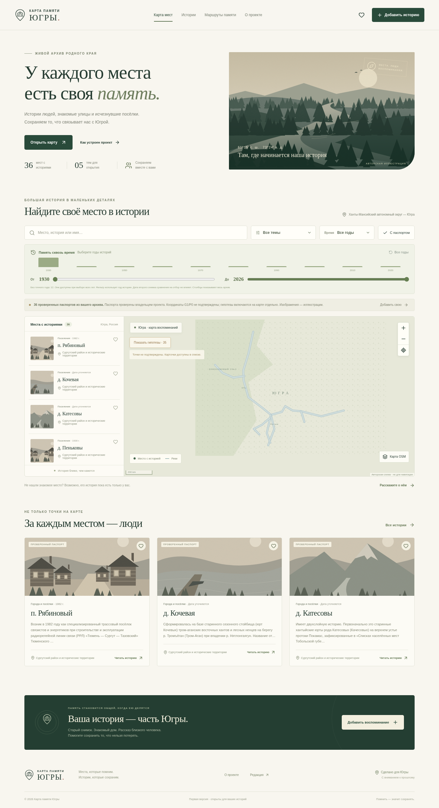

# Карта памяти Югры

Самостоятельное приложение живого архива (версия 0.2): интерактивная карта, истории мест и людей, воспоминания жителей и редакторская модерация. Исходники «Сплава» не используются и не изменяются.



## Что уже работает

- Адаптивный интерфейс на русском языке: карта, истории, тематические маршруты, страница проекта.
- 36 карточек объектов из предоставленных паспортов Сургутского района. Использован исправленный рабочий свод; копии и старый GPS-атлас не смешиваются с ним. По подтверждению владельца проекта от 29 октября 2026 года все 36 паспортов отмечены как проверенные. Дата и основание подтверждения сохранены в данных. Изображения — авторские иллюстрации, не архивные фотографии.
- 35 координатных гипотез доступны только после явного включения на карте. У Кедрового (`PAS-029`) координаты не установлены; прежняя точка не используется. У 12 объектов нет точного года: они доступны при выборе всех лет.
- Старые 8 демонстрационных примеров сохранены в БД для совместимости со ссылками, но скрыты из основного каталога после загрузки паспортов.
- Географические точки на Leaflet; собственная условная схема работает без внешних сервисов. По желанию посетителя — подложка OpenStreetMap с атрибуцией и возвратом к схеме при ошибке сети. Схема не предназначена для навигации.
- Поиск, фильтры по теме и десятилетию, временная шкала с диапазоном лет и распределением историй по десятилетиям, сортировка и скрытие демонстрационных материалов. Шкала отбирает по году истории, а не по дате второго снимка.
- Карточки с текстом, авторством и источниками; избранное в браузере; ссылки на отдельные истории.
- Отправка воспоминания с одним или двумя снимками до 2 МБ каждый (JPEG, PNG, WebP), источниками и согласием. Для пары — сравнение «тогда и сейчас» с ползунком, клавиатурным управлением и режимом просмотра рядом. Второй снимок не может предшествовать первому.
- Реальная SQLite-база. Отправленный материал не публикуется до решения редактора. Частные контакты не выдаются публичным API; неопубликованные фотографии закрыты от посетителей.
- Кабинет редактора: очередь, просмотр, уточнение текста, дат, координат и источников перед публикацией, история исходной и исправленной версии, публикация и отклонение. Конфликтующие изменения и публикация устаревшей версии блокируются. Системные поля, согласие, частный контакт и владельцы фотографий не редактируются этим API.
- Пароли редакторов хешируются через scrypt; серверные сессии с HttpOnly/SameSite cookie, выход отзывает сессию. Встроенных паролей, публичной регистрации редакторов и назначения прав по email нет.
- Ограничение запросов к входу и отправке материалов, проверка данных на сервере, защита от запросов с чужого сайта. Пользовательский текст выводится как текст, включая подписи на карте.

## Карточки из паспортов объектов

В форме отправки материала и в редакторской правке есть раздел **«Сведения из паспорта объекта»**. Можно перенести официальное название и вид объекта, датировку, местоположение, состояние и охранный статус. Название документа-источника обязательно; его дата, архивный шифр/страница и HTTPS-ссылка необязательны. Пустые характеристики не подменяются выдуманными значениями. После модерации в карточке появляется отдельный паспорт с источником. Редакторские уточнения сохраняются в закрытой истории.

**Паспорта получены 28 октября 2026 года** в архиве «Паспорта исчезнувших поселений ХМАО». В `server/data/passports.json` включены 36 карточек из исправленного свода. В карточках сохранены сведения о хозяйстве, демографии, административном статусе, датировке и источниках. Владелец проекта подтвердил проверку паспортов 29 октября 2026 года. Сохраняются конкретные сведения источника о статусе исторических слоёв и координатах: не все объекты являются исчезнувшими поселениями, а непроверенные полевой съёмкой точки не используются для навигации. Сводные воспоминания и поимённые списки не импортируются без отдельной проверки. Подробности и контрольная сумма документа — в [описании источников](docs/SOURCES.md).

Извлечение воспроизводится скриптом `python3 scripts/extract-passports.py /путь/к/исправленному.docx` (требуется Python и `python-docx`). Загрузка любых PDF/DOCX через сайт пока не реализована. Паспорт объекта не должен содержать личные документы, частные контакты или сведения, на публикацию которых нет согласия.

## Подтверждение паспортов

29 октября 2026 года владелец проекта подтвердил, что предоставленные паспорта проверены. В карточках отображается «Проверенный паспорт» с указанием владельца проекта как источника подтверждения. При обновлении существующей БД статус меняется без потери правок, дат и координат; удалённые записи не восстанавливаются. Название оригинального файла с пометкой «исправленная рабочая версия» сохраняется как название документа.

## Обновление с версии 0.1

Перед обновлением сделайте резервную копию (`npm run backup -- /закрытый/путь/backup.sqlite`), затем перезапустите сервер. SQLite добавляет поле версии материала и таблицу истории правок; существующие заявки, фотографии и публикации сохраняются. Удалённые владельцем демонстрационные карточки не появляются снова. 36 паспортных карточек добавляются один раз без перезаписи пользовательских публикаций и исправлений. Демонстрационные примеры сохраняются в БД, но больше не показываются в основном каталоге; ссылки на них продолжают работать. В одном из примеров есть явно подписанная иллюстрация сравнения.

В публичном API полей `year`, `latitude` и `longitude` может не быть точного значения: тогда передаётся `null`, а не фиктивный год или точка. Записи каталога имеют `verificationStatus: verified` с `verification.by: project_owner` и датой `verification.confirmedOn` и статус координат `hypothesis` или `unknown`.

Для API-клиентов: `POST /api/admin/submissions/:id` теперь требует актуальный `revision` из списка материалов. `PATCH /api/admin/submissions/:id` сохраняет уточнения, а `GET /api/admin/submissions/:id/history` возвращает закрытую историю. Оба изменения и просмотр истории требуют входа редактора. Сервер принимает JSON до 6 МБ, при этом каждый снимок ограничен 2 МБ.

## Запуск

Требуется **Node.js 24+**. SQLite входит в Node.js, отдельная БД не нужна.

```bash
git clone https://github.com/zuubra1985-hash/Karta-pamyati-Yugry.git
cd Karta-pamyati-Yugry
npx --yes bun@1.3.3 install --frozen-lockfile
npm run dev
```

Если Bun уже установлен: `bun install --frozen-lockfile`. Для закрытого репозитория сначала авторизуйтесь в GitHub.

В подготовленной облачной среде исходники находятся в `/workspace/Karta-pamyati-Yugry`, а Bun — в `/workspace/.tools/node_modules/.bin/bun`. Для повторной установки в ней используйте `BUN_TMPDIR=/tmp BUN_INSTALL=/workspace/.tools /workspace/.tools/node_modules/.bin/bun install --frozen-lockfile`.

По умолчанию сервер использует порт **3100** и слушает только `127.0.0.1`. В этой облачной среде приложение проверяется локальными HTTP-запросами; публичное размещение не выполнено. Для локальной сети задайте `HOST=0.0.0.0`. Не создавайте дополнительные Git worktree без необходимости: облачная задача уже изолирована.

### Первый редактор

В отдельном интерактивном терминале, из каталога проекта:

```bash
npm run admin:create
```

Введите email и дважды пароль длиной от 12 до 256 символов. Пароль не отображается и не сохраняется открытым текстом. Затем откройте **«Редакция»** внизу сайта. Повторный запуск для того же email меняет пароль и отзывает его сессии. По умолчанию редакторы не созданы; закрытый раздел не откроется без этого шага.

### Сборка и production

```bash
npm run build
npm start
```

Production использует Secure cookie: для входа редактора нужен **HTTPS** через обратный прокси. Укажите `APP_ORIGIN` с точным внешним адресом сайта (без завершающего `/`). Статика и API работают с одного origin. Для локальной работы через HTTP используйте `npm run dev`.

Переменные окружения:

| Имя | По умолчанию | Назначение |
|---|---|---|
| `PORT` | `3100` | Порт сервера |
| `HOST` | `127.0.0.1` | Адрес прослушивания |
| `MEMORY_DB` | `data/memory.sqlite` внутри проекта | Путь к БД, общий для сервера и CLI |
| `APP_ORIGIN` | Origin текущего запроса | Точный внешний HTTPS origin для production |
| `NODE_ENV` | development | `production` включает статику, CSP и Secure cookie |
| `CHROMIUM_PATH` | `/usr/bin/chromium` | Chromium для браузерных тестов |

## Проверки

```bash
npm test        # API, права, модерация, приватность, валидация, сохранение БД
npm run build  # строгая проверка TypeScript и production-сборка
npm run test:ui # сборка и сценарии в Chromium
```

Браузерные тесты требуют установленного Chromium. Все тесты используют изолированную временную БД и тестовые учётные записи; рабочий архив не засоряется. Проверяются поиск и фильтры, избранное после перезагрузки, отправка фото, публикация редактором, отсутствие утечки email, отображение HTML как текста и мобильное меню.

## Данные и резервная копия

Рабочие данные, фотографии, хеши паролей и сессии находятся в `data/memory.sqlite`; файлы `-wal` и `-shm` создаются SQLite. Каталог `data/` исключён из Git и поставляемого архива исходников. Не публикуйте его и не помещайте в каталог публичной статики.

```bash
npm run backup -- /безопасный/путь/memory-backup.sqlite
```

Резервная копия включает частные контакты и хеши — храните её с ограниченным доступом. Восстановление: остановите сервер, сохраните предыдущую БД, перенесите резервную копию на путь `MEMORY_DB`, уберите только старые файлы `-wal`/`-shm` соответствующей остановленной БД и запустите сервер. Не копируйте один SQLite-файл во время записи без SQLite backup/VACUUM: WAL может содержать последние изменения.

Паспортные карточки и демонстрационные примеры добавляются отдельными однократными миграциями. Чтобы удалить загруженную паспортную карточку без её повторного появления, удалите её из `places`, сохранив соответствующую запись в `metadata`. Демонстрационные карточки добавляются только один раз при создании БД. Для запуска совсем без примеров можно удалить их SQL-командой после резервного копирования: `DELETE FROM places WHERE json_extract(data, '$.demo') = 1;`. Метаданные инициализации сохранятся, и примеры не появятся снова. Реальные истории продолжат публиковаться через редакцию.

## Структура

- `src/` — React/TypeScript, адаптивный интерфейс.
- `src/components/MemoryMap.tsx` — Leaflet, локальная схема и опциональная OSM-подложка.
- `server/app.mjs` — API, валидация, доступ и защитные middleware.
- `server/store.mjs` — SQLite, модерация, пароли и сессии.
- `server/seed.mjs` — подписанные демонстрационные материалы.
- `public/images/` — оригинальные SVG-иллюстрации; генератор в `scripts/make-art.py`.
- `scripts/create-admin.mjs` — первоначальное создание редактора.
- `tests/` — серверные и браузерные проверки.

## Что нужно до публичного запуска

1. Дополнить проверенные паспорта архивными фотографиями с авторством и разрешениями. Географическую привязку уточнять отдельно для тех объектов, где в паспорте указана координатная гипотеза.
2. Создать редактора, настроить домен, HTTPS, постоянный диск и резервное копирование. В текущем прототипе один сервер; сессии и лимиты не предназначены для кластера.
3. Указать настоящие контакты редакции, сведения об операторе, условия обработки персональных данных и порядок исправления/удаления материалов. Сейчас интерфейс честно сообщает об отсутствии этих реквизитов.
4. Определить сроки хранения контактов и отклонённых материалов. Пока автоматического удаления и пользовательского кабинета для отзыва материалов нет; запросы обрабатывает владелец БД.
5. Перед публикацией фотографий проверять права, согласия и метаданные файлов, в том числе GPS. Фотографии сохраняются как переданы; автоматического удаления EXIF, антивирусной проверки и перекодирования в этой версии нет.

## Следующие этапы

Уточнение координатных гипотез, привязка мест и добавление архивных фотографий; исторические картографические подложки; аудиоистории с расшифровкой; исправления уже опубликованных материалов; кабинет автора; отдельные страницы людей и семей; Telegram Mini App; интеграции с музеями и архивами. Эти возможности пока не реализованы и не имитируются кнопками.
